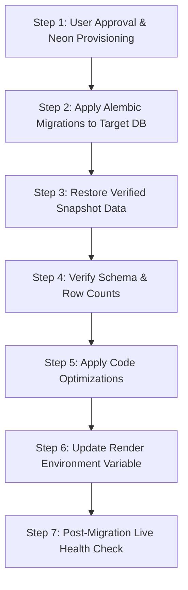

# Neon Free Database Safe Migration Plan

**Document Version**: 1.0  
**Target Environment**: Neon Serverless PostgreSQL (Free Tier)  
**Status**: DRAFT / PENDING USER APPROVAL  
*(Do not execute migration or alter production credentials without explicit user confirmation)*  

---

## 1. Migration Overview & Strategy

The current Neon database (`swing-trading`, project `crimson-mountain-88821720`) was locked by Neon on November 9, 2026 due to exceeding the 5.0 GB public data egress quota (HTTP status 402: Payment Required). Incoming SQL connections are rejected at the proxy layer until the quota resets on December 1, 2026.

### Recommended Migration Path:
Rather than waiting for the monthly billing cycle reset or upgrading to a paid tier, we can safely migrate to a **fresh Neon Free project** while:
1. Re-creating the complete schema deterministically via existing **Alembic migrations**.
2. Restoring all verified trading, operational, and historical records from the latest verified snapshot:
   `data/backups/neon_pg_backup_20261106_182900.json` (SHA-256 integrity verified).
3. Applying optimization rules (auto-suspend = 300s, market-hours scheduler gating, connection pool downsizing) immediately from Day 1 to ensure the new project never breaches free tier quotas.

---

## 2. Target Neon Project Specifications

The new project should be configured with the following serverless parameters:

| Parameter | Recommended Value | Rationale |
|---|---|---|
| **Project Name** | `swing-trading-v2` | Distinct from locked legacy project |
| **Region** | `aws-ap-southeast-1` (Singapore) | Lowest latency to Indian exchanges & Render Singapore |
| **PostgreSQL Version** | `18` or `16` | Consistent with current schema (v18) |
| **Compute Sizing** | Min: 0.25 CU, Max: 1.0 CU | Minimal consumption; 0.25 CU is optimal for single-user swing trading |
| **Autosuspend Delay** | **`300 seconds` (5 minutes)** | **MANDATORY**: Allows scale-to-zero during market-closed periods |
| **Connection Pooling** | Enable Neon PgBouncer (`-pooler`) | Handles connection recycling gracefully |
| **Free Tier Quotas** | 1.0 GB Storage, 100 CU-hr Compute, 5.0 GB Egress | Protected by our optimization plan |

---

## 3. Data Inventory & Restoration Scope

The verified backup snapshot `data/backups/neon_pg_backup_20261106_182900.json` (28.41 MB) contains:

| Table | Backup Row Count | Migration Action | Verification Method |
|---|---|---|---|
| `positions` | 1 | Restore | Exact row match |
| `fills` | 2 | Restore | Exact row match |
| `journal` | 1 | Restore | Exact row match |
| `signals` | 108 | Restore | Count & state verification |
| `alerts` | 3 | Restore | Exact row match |
| `settings_kv` | 1 | Restore | Exact row match |
| `news_source_state` | 4 | Restore | ETag & cursor integrity |
| `earnings_filings` | 1 | Restore | Exact row match |
| `decision_audits` | 2,331 | Restore (Optionally prune to last 14 days) | Timestamp boundary check |
| `decision_stage_results` | 16,317 | Restore (Corresponding to audits) | Foreign key check |
| `news_events` | 5,200 | Restore (Prune `raw_json` or articles > 30d) | Dedupe key check |
| `instruments` | 0 in snapshot | Repopulate via `job_universe_master_sync` | Instrument count check |
| `bars_daily` | 0 in snapshot | Repopulate via daily bar cache / provider chain | Daily bar continuity check |

---

## 4. Step-by-Step Execution Procedure



### Step 1: Pre-Migration & Target Provisioning
1. Obtain user approval.
2. Verify available slots in user's Neon account (Free plan allows 1 project; if existing project is deleted or upgraded, or new organization/account used, create project `swing-trading-v2`).
3. Obtain new database connection string:
   `postgresql://[user]:[password]@[endpoint]-pooler.ap-southeast-1.aws.neon.tech/neondb?sslmode=require`
4. Set endpoint `suspend_timeout_seconds = 300` immediately via Neon Console or API.

### Step 2: Apply Alembic Migrations
Run Alembic against the new connection string to build the pristine schema:
```bash
# Point temporary shell to target database
$env:DATABASE_URL = "postgresql://[user]:[password]@[new-endpoint]-pooler.ap-southeast-1.aws.neon.tech/neondb?sslmode=require"

# Execute all migrations up to head
backend/.venv/Scripts/alembic -c backend/alembic.ini upgrade head
```
*Expected Output*: Revisions `001_initial_neon_pg`, `002_live_data_reliability_and_alerts`, `003_signal_fundamental_snapshot`, `004_historical_ingestion_and_split_adjusted_ohlc` applied successfully.

### Step 3: Restore Snapshot Operational Data
Execute restoration using `backend/app/db_backup.py:restore_database_backup`:
```bash
backend/.venv/Scripts/python -c "from pathlib import Path; from app.db_backup import restore_database_backup; restore_database_backup(Path('data/backups/neon_pg_backup_20261106_182900.json'))"
```
*Verification*: Ensure SHA-256 checksum matches and all records populate without foreign key violations.

### Step 4: Schema & Data Integrity Verification
Execute verification script against the new database:
1. Check table existence for all 31 ORM models (`Base.metadata.tables`).
2. Verify row counts:
   - `positions`: 1
   - `fills`: 2
   - `journal`: 1
   - `signals`: 108
   - `alerts`: 3
3. Confirm primary keys and unique constraints are active.

### Step 5: Deploy Code Optimizations Prior to Production Traffic
Before pointing Render to the new database, ensure the following codebase optimizations are merged:
1. `backend/app/db.py`: `pool_size=3`, `max_overflow=5`, `pool_recycle=180`.
2. `backend/app/scheduler/jobs.py`: Add market-hours gating to `live_monitor_IN` and `live_monitor_US`.
3. `backend/app/scheduler/jobs.py`: Silence routine `JobRun` writes for 60s monitor ticks.
4. `backend/app/providers/manager.py`: Bulk upsert for daily bar caching.
5. Add `job_db_cleanup` retention job.

### Step 6: Update Render Environment Variable
1. In the Render Dashboard (Web Service `algo-trading-backend`):
   Update `DATABASE_URL` to the new Neon connection string.
2. Trigger manual deploy or let Render restart with the new variable.

### Step 7: Post-Migration Monitoring
1. Monitor Render startup logs (`/api/health` should return `200 OK`).
2. Monitor Neon Console metrics:
   - Active connections: 1-3.
   - Autoscaling: Stays at 0.25 CU.
   - After market close: Compute enters `suspended` state within 5 minutes.

---

## 5. Rollback Strategy

If any failure occurs during migration:
1. **Application Rollback**: Revert `DATABASE_URL` on Render to the previous value.
2. **Local Data Safety**: Local backups in `data/backups/` are immutable and SHA-256 verified; no historical data can be lost.
3. **Target Teardown**: If the new Neon project configuration is unsatisfactory, it can be deleted with zero impact on existing local state or legacy locked branch.

---

## 6. Pre-Migration Approval Checklist

Before proceeding to execution, the following decisions require user approval:

- [ ] **Approval to provision new Neon project**: Confirm whether to create a new project in the existing organization or if the user will provide credentials for a fresh Neon project.
- [ ] **Data retention cutoff**: Confirm whether to restore all 16,317 stage results or prune decision audits older than 14 days during migration.
- [ ] **Code optimizations**: Confirm authorization to apply the market-hours scheduler gating and connection pool adjustments.
