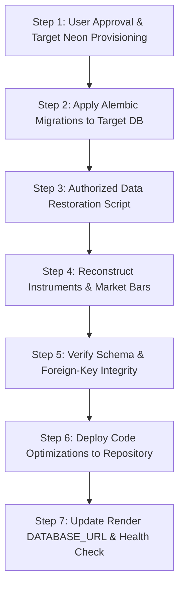

# Neon Free Database Safe Migration Plan

**Document Version**: 1.1 (Corrected & Verified)  
**Target Environment**: Neon Serverless PostgreSQL (Free Tier)  
**Status**: DRAFT / PENDING USER APPROVAL  
*(Do not execute migration, create projects, or alter production credentials without explicit user confirmation)*  

---

## 1. Migration Overview & Strategy

The current Neon database (`swing-trading`, project `crimson-mountain-88821720`) was locked by Neon on November 9, 2026 due to exceeding the 5.0 GB public data egress quota (HTTP status 402: Payment Required). Incoming SQL connections are rejected at the proxy layer until the quota resets on December 1, 2026.

### Migration Architecture:
To regain database connectivity on a Neon Free tier without waiting for the billing cycle reset:
1. **Schema Recreation**: Re-create the complete 31-table schema deterministically via existing **Alembic migrations** (`alembic upgrade head`).
2. **Operational Data Restoration**: Restore verified operational records from the verified snapshot (`data/backups/neon_pg_backup_20261106_182900.json`).
3. **Missing Data Reconstruction**: Explicitly re-ingest market data (`bars_daily`) and universe metadata (`instruments`) through authorized upstream provider pipelines, acknowledging that they are not stored in the JSON backup.
4. **Day-1 Guardrails**: Enforce endpoint autosuspend (`suspend_timeout_seconds: 300`) and scheduler off-market gating from Day 1 to avoid recurrence of quota exhaustion.

---

## 2. Target Neon Project Specifications

The new project should be configured with the following serverless parameters:

| Parameter | Recommended Value | Rationale |
|---|---|---|
| **Project Name** | `swing-trading-v2` | Distinct from locked legacy project |
| **Region** | `aws-ap-southeast-1` (Singapore) | Lowest latency to Indian exchanges & Render Singapore |
| **PostgreSQL Version** | `18` or `16` | Consistent with current schema (v18) |
| **Compute Sizing** | Min: 0.25 CU, Max: 1.0 CU | Minimal consumption; 0.25 CU is optimal for single-user swing trading |
| **Autosuspend Delay** | **`300 seconds` (5 minutes)** | **MANDATORY**: Allows scale-to-zero during market-closed periods |
| **Connection Pooling** | Enable Neon PgBouncer (`-pooler`) | Handles connection recycling gracefully |
| **Free Tier Quotas** | 1.0 GB Storage, 100 CU-hr Compute, 5.0 GB Egress | Protected by our optimization plan |

---

## 3. Data Inventory & Completeness Audit

### 3.1 Backup File Verification
- **Verified Backup File**: `data/backups/neon_pg_backup_20261106_182900.json` (29,793,823 bytes).
- **Verified SHA-256 Checksum**: `76fd605b94ed554e7ead7c3949d81f5eab1e6b64d6f54eff539b49457ecae9da` (Calculated checksum matches expected exactly).

### 3.2 Table Restoration vs Reconstruction Scope

The backup snapshot contains only **13 operational tables** selected by `tables_to_backup` in `app/db_backup.py`. The remaining 18 tables in the ORM schema must be handled according to their source:

| Table Name | Backup Row Count | Action | Method / Procedure |
|---|---|---|---|
| `positions` | 1 | Restore | Direct record insertion from JSON snapshot |
| `fills` | 2 | Restore | Direct record insertion from JSON snapshot |
| `journal` | 1 | Restore | Direct record insertion from JSON snapshot |
| `signals` | 108 | Restore | Direct record insertion from JSON snapshot |
| `alerts` | 3 | Restore | Direct record insertion from JSON snapshot |
| `settings_kv` | 1 | Restore | Direct record insertion from JSON snapshot |
| `news_source_state` | 4 | Restore | Direct record insertion from JSON snapshot |
| `earnings_filings` | 1 | Restore | Direct record insertion from JSON snapshot |
| `decision_audits` | 2,331 | Restore | Direct record insertion (parent table) |
| `decision_stage_results` | 16,317 | Restore | Direct record insertion (child table via `audit_id`) |
| `news_events` | 5,200 | Restore | Direct record insertion from JSON snapshot |
| `instruments` | **0 in backup** | **Reconstruct** | Populate via universe sync (`data/universe/research_universe_v1.csv`) |
| `bars_daily` | **NOT IN BACKUP** | **Reconstruct** | Re-cache from upstream market data providers (Angel One / yfinance) |
| `job_runs` | **NOT IN BACKUP** | Start Clean | Ephemeral runtime logs; no historical restoration required |
| `scans` | **NOT IN BACKUP** | Start Clean | Daily EOD scan logs populate on subsequent runs |
| `custom_price_alerts` | **NOT IN BACKUP** | Re-create | User-configured alerts entered manually or seeded |
| `watchlists` / `items` | **NOT IN BACKUP** | Re-create | Re-seeded from default watchlist definitions |

> [!IMPORTANT]
> **Clarification on `restore_database_backup()`**:
> Code inspection of `backend/app/db_backup.py` reveals that `restore_database_backup()` currently only reads the JSON file, verifies the SHA-256 checksum, tallies record lengths into a dictionary, and calls `sess.commit()`. **It does NOT perform SQL insertions or restore records into the database.**
> Implementing an authorized restoration script is NOT permitted during this audit phase. When migration execution is explicitly approved by the user, a proper insertion routine (or SQL import script) will need to be authored.

---

## 4. Reconstruction & Validation Plan for Missing Data

1. **`instruments` Master Data**:
   - Source: `data/universe/research_universe_v1.csv` and Angel One local cache `data/cache/angelone/instrument_master.json`.
   - Reconstruction: Execute `job_universe_master_sync(db)` to populate the `instruments` table with all active symbols and tokens.
   - Validation: Confirm row count matches active universe (~176 Indian equities, ~100 US equities).
2. **`bars_daily` Historical Market Bars**:
   - Source: Upstream market data providers (Angel One REST API for IN; yfinance for US).
   - Reconstruction: Trigger daily bar cache backfill via `provider_manager.get_daily_bars(symbols, start, end, market, db=db)`.
   - Validation: Query `SELECT COUNT(DISTINCT symbol), MIN(date), MAX(date) FROM bars_daily` to confirm unbroken daily series across all active symbols.
3. **`custom_price_alerts` & `watchlists`**:
   - Reconstructed from user input or UI seed definitions.

---

## 5. Step-by-Step Execution Workflow (Pending Approval)



### Step 1: Target Neon Provisioning & Settings (User Action Required)
1. User creates or provisions a fresh Neon project in `aws-ap-southeast-1` named `swing-trading-v2`.
2. Ensure endpoint autosuspend is explicitly set:
   `suspend_timeout_seconds = 300` (5 minutes).
3. Obtain connection string for pooled host:
   `postgresql://[user]:[password]@[endpoint]-pooler.ap-southeast-1.aws.neon.tech/neondb?sslmode=require`.

### Step 2: Apply Alembic Migrations
Run Alembic against the new connection string to build the pristine 31-table schema:
```bash
$env:DATABASE_URL = "postgresql://[user]:[password]@[new-endpoint]-pooler.ap-southeast-1.aws.neon.tech/neondb?sslmode=require"
backend/.venv/Scripts/alembic -c backend/alembic.ini upgrade head
```

### Step 3: Execute Authorized Restoration
*(Requires authoring an insertion routine, deferred until explicit migration authorization)*:
- Insert parent tables first: `decision_audits`, `positions`.
- Insert child tables: `decision_stage_results` (referencing `audit_id`), `fills` (referencing `position_id`).
- Insert standalone tables: `signals`, `alerts`, `news_events`, `news_source_state`, `settings_kv`, `earnings_filings`.

### Step 4: Reconstruct Universe & Data
- Run universe sync to populate `instruments`.
- Ingest required daily bars for active watchlists.

### Step 5: Integrity Verification
- Verify row counts against Section 3.2.
- Verify foreign-key constraints and index presence.

### Step 6: Deploy Optimizations & Update Render
- Deploy market-hours scheduler gating, bulk upsert, and connection pool sizing.
- Update `DATABASE_URL` in Render Dashboard.
- Verify `/api/health` returns `200 OK`.

---

## 6. Rollback Strategy

1. **Immutable Backup Safety**: `data/backups/neon_pg_backup_20261106_182900.json` is immutable and stored locally with verified checksum `76fd605b...`.
2. **Reversible Environment Variable**: If the new database exhibits errors, reverting `DATABASE_URL` on Render immediately restores previous settings.
3. **No Risk to Legacy Data**: The locked legacy project (`crimson-mountain-88821720`) remains completely untouched in Neon until billing reset on December 1, 2026.

---

## 7. Migration Prerequisites Checklist

Before migration can proceed to implementation:

- [ ] **Target Database Ready**: User must provision new project or provide target connection string.
- [ ] **Author Restoration Logic**: Author an actual record insertion script (since `db_backup.restore_database_backup` does not insert).
- [ ] **Market Data Reconstruction Strategy**: User must confirm whether to re-ingest all daily bars or let the system populate them on-demand.
- [ ] **Decision Audits Pruning Decision**: User must confirm whether to migrate all 16,317 stage results or prune records older than 14/30 days.
- [ ] **Code Changes Authorization**: Explicit approval to commit scheduler market-hours gating and connection pool adjustments.
